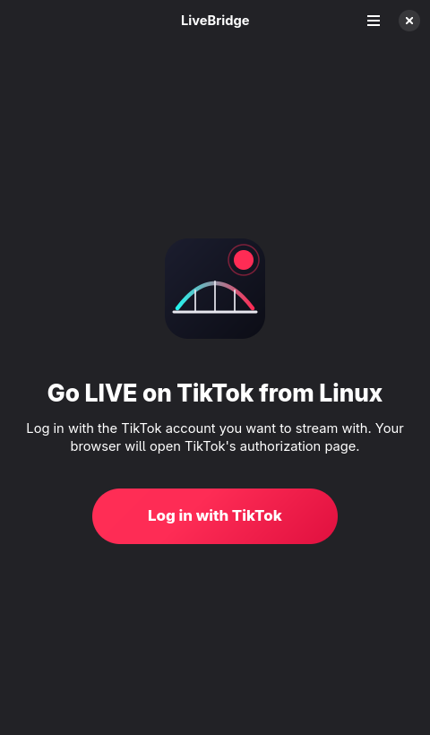
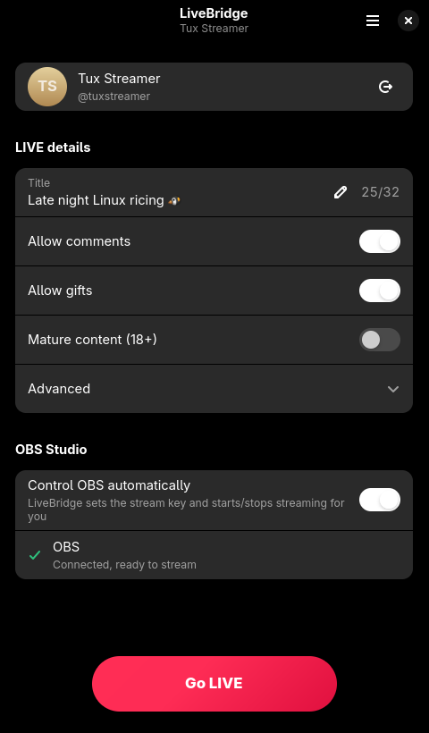
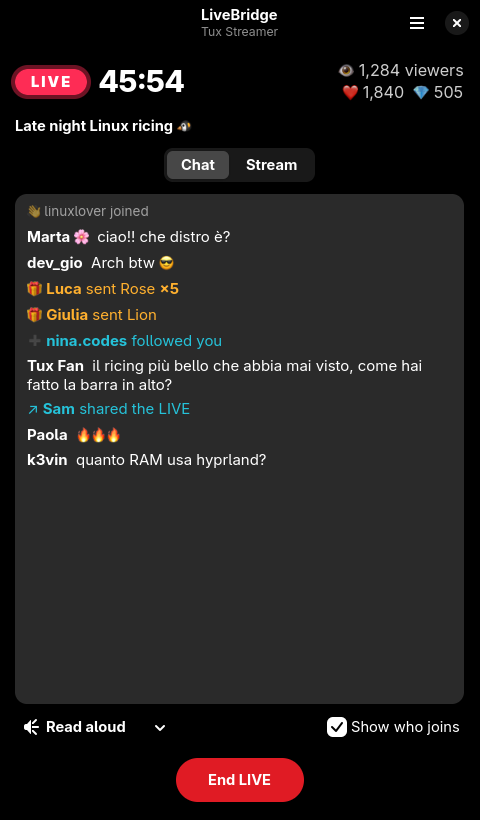

<div align="center">


# LiveBridge

**Go LIVE on TikTok from Linux, with OBS.**

TikTok LIVE Studio only exists for Windows and macOS. LiveBridge talks to TikTok the same way LIVE Studio does, gets your stream key and drives OBS for you. No Wine, no VM, no copying keys around.

  

</div>

## Features

- **One-click login** through TikTok's own authorization page in your browser. LiveBridge never sees your password.
- **Go LIVE in one click**: it creates the LIVE, puts the server and key into OBS and starts streaming.
- **Automatic OBS setup**: turns on the OBS WebSocket server for you and opens OBS if it's closed. Works with native and Flatpak OBS.
- **Live chat in the app**: comments, gifts (combos update in place), follows, shares, plus likes and 💎 diamond counters.
- **Read the chat aloud**: natural offline voice (Piper, downloaded with one click) or your system's speech engine. Choose comments, gifts and/or follows, and set the speed; a skip button clears the queue.
- **Live dashboard**: timer, viewer count, heartbeat status and the bitrate OBS is sending.
- **Keeps your LIVE alive**: TikTok ends a LIVE whose app stops responding, so LiveBridge sends the same heartbeat LIVE Studio does.
- **Crash-safe**: if LiveBridge closes while you're LIVE, it offers to resume or end that LIVE when you reopen it.
- **Manual mode** for any other streaming software: copy the server and key with one click.
- **CLI included** for headless setups and scripts.
- Native GTK 4 / libadwaita app, light and dark theme, English and Italian.

## Install

You need Python 3, GTK 4 and libadwaita ≥ 1.5 (preinstalled on most modern desktops), plus [OBS Studio](https://obsproject.com/).

```bash
# 1. dependencies
sudo pacman -S --needed python-gobject gtk4 libadwaita obs-studio      # Arch / Manjaro / EndeavourOS
sudo apt install python3-gi gir1.2-gtk-4.0 gir1.2-adw-1 obs-studio     # Debian 13+ / Ubuntu 24.04+
sudo dnf install python3-gobject gtk4 libadwaita obs-studio            # Fedora

# 2. LiveBridge
git clone https://github.com/cpstest-tech/livebridge.git
cd livebridge
./install.sh
```

Then open **LiveBridge** from your app menu. Everything is installed under your home folder, no root needed. To remove it, run `./install.sh --uninstall`.

## How to use

1. **Log in with TikTok.** Your browser opens TikTok; approve the request. When the browser asks to open LiveBridge, allow it.
2. If OBS shows **"WebSocket server is off"**, close OBS and press **Set up**. You only do this once.
3. Set up your scenes in OBS as usual. For a vertical LIVE, use a 1080×1920 canvas (Settings › Video).
4. Type a title and press **Go LIVE**.
5. Press **End LIVE** when you're done. Keep LiveBridge open while you stream.

### Command line

```text
livebridge login             log in (browser)
livebridge status            account, LIVE permission and OBS status
livebridge start -t "Title"  go LIVE and keep it alive (Ctrl+C ends it)
livebridge start --tts       …and read the chat aloud
livebridge start --no-obs    just print server and key
livebridge stop              end a LIVE that is still open
livebridge logout
```

## FAQ

**Do I need LIVE access on my account?**
Yes. TikTok decides who can go LIVE (age, followers, region…). If your account can use TikTok LIVE Studio, it can use LiveBridge.

**Why must LiveBridge stay open during the LIVE?**
TikTok expects a heartbeat from the streaming app every few seconds. Without it, the LIVE ends after a short time. LIVE Studio works the same way.

**The browser didn't come back to the app after login.**
On the waiting screen, paste the `live-studio-app://…` link into the box. You can find it in your browser's address bar or its "open external application" prompt.

**OBS says "Can't connect".**
Restart OBS. If you changed the WebSocket password by hand, LiveBridge reads it from OBS's config. Restart OBS so both sides agree.

**Which voice reads the chat?**
The first time you turn on *Read aloud*, LiveBridge offers to download [Piper](https://github.com/rhasspy/piper) and a voice for your language (~90 MB, into `~/.local/share/livebridge`). If you already have `spd-say` or `espeak-ng`, it can use those instead.

**Is my login safe?**
The session cookies stay on your computer in `~/.config/livebridge/` (readable only by you). LiveBridge only talks to TikTok's servers and to OBS on `localhost`.

## How it works

LiveBridge reimplements the network protocol of TikTok LIVE Studio 1.40 for Windows:

| Step | Request |
|---|---|
| Start login | `POST webcast.tiktokv.com/passport/oidc/prepare/` |
| Authorize | browser → `tiktok.com/ucenter_web/onetap_auth` → `live-studio-app://login/continue?id_token=…` |
| Region | `POST …/passport/web/region/` → regional passport domain |
| Session | `POST https://<region>/passport/oidc/login/` → session cookies |
| Go LIVE | `POST webcast16-normal-<region>/webcast/room/create/` → `stream_url.rtmp_push_url` |
| Heartbeat | `POST /webcast/room/ping/anchor/` every 5 s (`status` 2 = live, 4 = end) |
| Chat | `GET /webcast/im/fetch/` (protobuf) → push server → WebSocket with gzip `PushFrame`s, acks and heartbeats |

OBS is controlled through [obs-websocket v5](https://github.com/obsproject/obs-websocket), built into OBS 28+. LiveBridge uses only the Python standard library plus PyGObject.

## Disclaimer

LiveBridge is an unofficial, independent project. It is **not affiliated with, endorsed by or connected to TikTok or ByteDance**. "TikTok" is a trademark of its owner and is used here only to describe what this software works with. LiveBridge uses private APIs that can change at any time. Using unofficial clients may break TikTok's terms of service. Use it at your own risk, on accounts you own.

## License

[MIT](LICENSE)
